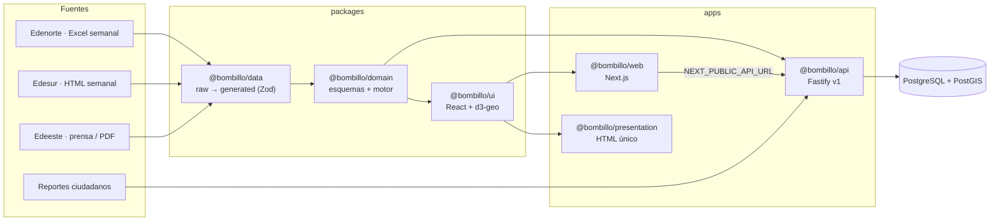

# Arquitectura

## Paquetes

| Paquete                  | Responsabilidad                                                                | Depende de       |
| ------------------------ | ------------------------------------------------------------------------------ | ---------------- |
| `@bombillo/domain`       | Esquemas Zod (fuente única de tipos) y motor de simulación puro y determinista | zod              |
| `@bombillo/data`         | Fuentes crudas + script que genera `generated/dataset.json` validado           | domain, exceljs  |
| `@bombillo/ui`           | Componentes React compartidos y el puerto `DataSource`                         | domain, data, d3 |
| `@bombillo/api`          | API REST v1, validación, errores uniformes, rate limit, repositorios           | domain, data     |
| `@bombillo/web`          | Producto web (Next.js App Router); modo demo o modo API                        | ui               |
| `@bombillo/presentation` | Un `index.html` autocontenido para presentar desde el celular                  | ui               |

## Decisiones clave

- **El código de circuito es la llave del sistema.** Las EDE operan por circuito; los barrios cambian de nombre entre publicaciones. Cuando una fuente no da código (Edesur), se crea un circuito sintético `SIM-…` marcado como simulado.
- **Procedencia en cada registro** (`official` · `press` · `simulated`). La UI la muestra siempre.
- **Motor puro y determinista.** `buildTimeline(escenario, dataset)` calcula los cortes una vez; `getSnapshot(timeline, dataset, t)` es una consulta. Mismo resultado en servidor, navegador y tests.
- **Puertos y adaptadores.** La API depende de `OutageRepository` (memoria o Postgres); la UI de `DataSource` (local o API).
- **Mapa vectorial sin teselas** (d3-geo + SVG): funciona sin conexión y en el HTML único. Ver ADR 0002.

## API v1

| Método | Ruta                                         | Descripción                                                   |
| ------ | -------------------------------------------- | ------------------------------------------------------------- |
| GET    | `/health`                                    | Estado del servicio                                           |
| GET    | `/v1/provinces`                              | Provincias                                                    |
| GET    | `/v1/circuits?provinceId&ede&q&limit&cursor` | Circuitos con paginación por cursor                           |
| GET    | `/v1/circuits/:code`                         | Ficha de un circuito                                          |
| GET    | `/v1/planned-outages?from&to&ede`            | Cortes programados en un rango                                |
| GET    | `/v1/scenarios`                              | Escenarios (sin la semilla interna)                           |
| GET    | `/v1/scenarios/:id/timeline`                 | Línea de tiempo completa (cacheable)                          |
| GET    | `/v1/scenarios/:id/snapshot?at`              | Fotografía en un instante                                     |
| GET    | `/v1/scenarios/:id/circuits/:code?at`        | Estado e historial de un circuito                             |
| POST   | `/v1/reports`                                | Reporte ciudadano (202, límite 3 por dispositivo cada 10 min) |

Errores con formato uniforme: `{ type, title, status, issues? }`.

## Próximas capas (producción)

1. **Ingesta programada:** jobs BullMQ por EDE, tabla `raw_documents` con hash para idempotencia.
2. **Consenso real:** agregación de `citizen_reports` por circuito en ventanas de 30 min; reputación por dispositivo.
3. **Tiempo real:** SSE + pub/sub de Redis.
4. **Notificaciones:** Expo push con fan-out por sector suscrito.
5. **Observabilidad:** logs estructurados (pino), métricas y alertas si un parser falla.
