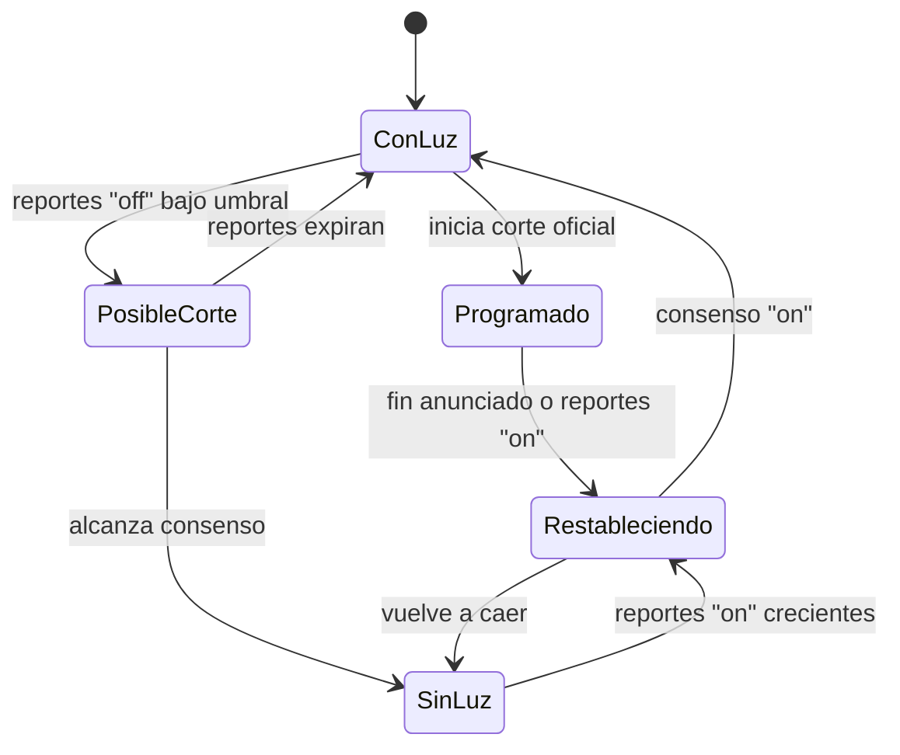

# Estrategias y lógica del sistema

Cómo debe funcionar cada pieza cuando pase de demo a producto. Cada sección indica qué existe hoy y qué falta.

---

## 1. Ingesta de fuentes oficiales

**Hoy:** `packages/data/scripts/build-seed.ts` lee archivos guardados a mano.
**Meta:** un worker que descarga, guarda, parsea y normaliza solo.

### Pipeline

```
descargar ─► guardar crudo ─► ¿cambió? ─► parsear ─► validar ─► normalizar ─► upsert ─► publicar evento
 (undici)   (raw_documents)   (sha256)   (adaptador)  (Zod)   (circuitos/zonas)  (idempotente)  (Redis)
```

1. **Un adaptador por fuente** con la misma interfaz:

   ```ts
   interface SourceAdapter {
     id: "edenorte-excel" | "edesur-html" | "edeeste-prensa";
     discover(): Promise<DocumentRef[]>; // qué documentos nuevos hay
     parse(doc: RawDocument): Promise<ParsedOutage[]>; // crudo → registros
   }
   ```

2. **Guardar el crudo antes de parsear.** Si el parser falla o se mejora, se reprocesa todo sin volver a descargar. La tabla `raw_documents` ya existe en la migración.
3. **Idempotencia por hash.** Si el `sha256` del documento ya existe, no se hace nada. Cada corte tiene un `id` estable (`edn-<circuito>-<fecha>-<hora>-<equipo>`), así que un `INSERT … ON CONFLICT` no duplica.
4. **Frecuencia:**

   | Fuente   | Cuándo publica                                       | Frecuencia del job                        |
   | -------- | ---------------------------------------------------- | ----------------------------------------- |
   | Edenorte | Post semanal con Excel, normalmente jueves o viernes | Cada 6 h jueves a sábado; diario el resto |
   | Edesur   | Página semanal                                       | Cada 6 h                                  |
   | Edeeste  | Avisos diarios en prensa                             | Cada hora de 6:00 a 22:00                 |

5. **Alertas del pipeline:** si un adaptador devuelve 0 registros en una semana donde siempre hay datos, o falla la validación, se avisa al equipo. Un sitio que cambia de formato es el fallo más probable.
6. **Buen ciudadano web:** respetar `robots.txt`, identificarse con un `User-Agent` con contacto, usar `If-Modified-Since` y no más de una petición por segundo por sitio.

---

## 2. Normalización de zonas (resolución de entidades)

El problema más difícil. "Bo. Los Melones", "Los Melones" y "Barrio Los Melones (parcial)" son el mismo sector.

1. **Limpiar:** minúsculas, sin acentos, quitar prefijos (`bo.`, `res.`, `urb.`, `ens.`, `sector`), extraer marcas (`parcial`, `parcial 20%`).
2. **Buscar en el catálogo** de sectores (de OpenStreetMap o la ONE) con `pg_trgm`:

   ```sql
   SELECT id, name, similarity(name_norm, $1) AS score
   FROM sectors
   WHERE municipality_id = $2 AND name_norm % $1
   ORDER BY score DESC LIMIT 3;
   ```

3. **Umbral:** con score de 0.6 o más se acepta automáticamente. Entre 0.4 y 0.6 va a una cola de revisión humana. Por debajo se guarda como zona sin resolver.
4. **Tabla de alias:** cada corrección humana se guarda (`"bo. los melones" → sector 4821`) y la próxima vez se resuelve sin preguntar. Con el tiempo, la revisión manual tiende a cero.
5. **Circuito ↔ sector:** relación de muchos a muchos con peso (qué fracción del sector alimenta el circuito), aprendida de las publicaciones y de los reportes.

---

## 3. Reportes ciudadanos y consenso

**Hoy:** el motor simula reportes y aplica un umbral fijo de 5 reportes en 30 minutos (`CONSENSUS_THRESHOLD`).
**Meta:** un estado por zona calculado a partir de reportes reales con pesos.

### Unidad espacial: celdas H3

Cada reporte se asigna a una celda H3 de resolución 8 (unos 0.7 km²). Ventajas:

- **Privacidad:** nunca se muestra el punto exacto, solo la celda.
- **Consenso local:** se comparan reportes de vecinos reales, no de toda la provincia.
- **Escala:** agrupar por `cell_id` es un `GROUP BY` simple e indexable.

### Puntaje de una celda

En una ventana de 30 minutos:

```
score_sin_luz = Σ peso(reporte) para reportes "off" · decaimiento(edad)
score_con_luz = Σ peso(reporte) para reportes "on"  · decaimiento(edad)

peso(reporte)   = reputación del dispositivo (0.2 a 1.5)
decaimiento     = exp(-edad_min / 15)
```

| Condición                                                 | Estado de la celda                      |
| --------------------------------------------------------- | --------------------------------------- |
| `score_sin_luz ≥ 3` y `score_sin_luz > 2 × score_con_luz` | **Sin luz (confirmado)**                |
| `score_sin_luz ≥ 1` pero sin llegar al umbral             | **Posible corte** (se muestra tenue)    |
| `score_con_luz` domina                                    | **Con luz**                             |
| Hay corte programado oficial vigente                      | **Programado**, aunque no haya reportes |

Si el estado confirmado contradice lo oficial (dice "con luz" pero hay reportes de corte), se muestra como **avería no programada**, que es justamente la información que nadie más tiene.

### Máquina de estados por circuito



Las transiciones se guardan como eventos (`circuit_state_events`). Así se puede reconstruir la historia, medir duración real de cortes y calcular las estadísticas del panel B2G.

---

## 4. Anti-abuso

Capas, de la más barata a la más cara:

1. **Límite por dispositivo:** 3 reportes cada 10 minutos (ya implementado en `POST /v1/reports`).
2. **Límite por IP** con `@fastify/rate-limit` (ya activo de forma global).
3. **Coherencia geográfica:** el reporte debe caer dentro de RD (validado) y, con H3, cerca de la ubicación previa del dispositivo; saltos imposibles bajan la reputación.
4. **Reputación:** sube cuando el reporte coincide con el consenso o con un corte oficial; baja cuando contradice todo. Dispositivos nuevos empiezan con peso 0.5.
5. **Detección de ráfagas:** muchos dispositivos nuevos reportando en la misma celda en poco tiempo se marcan para revisión en vez de confirmar el corte.
6. **Attestation del dispositivo** (Play Integrity / App Attest) en la app móvil, cuando haya escala.

La demo ya muestra "reportes descartados por el filtro anti-abuso" en la ficha del circuito.

---

## 5. Notificaciones

1. El usuario se suscribe a **sectores**, no a circuitos (la gente no sabe su circuito).
2. Evento de cambio de estado ⇒ job en la cola `notify` ⇒ fan-out a los dispositivos suscritos, en lotes de 100 (límite de Expo Push).
3. **Reglas para no cansar:**
   - Un aviso al irse y uno al volver, no por cada reporte.
   - Esperar 10 minutos de estado estable antes de avisar "volvió la luz" (evita parpadeos).
   - Horario silencioso configurable (por defecto de 22:00 a 6:00, salvo emergencias).
   - Avisar los cortes programados la noche anterior a las 19:00.
4. Registrar entregas fallidas y borrar los tokens inválidos.

---

## 6. Tiempo real y caché

- **SSE** (Server-Sent Events) en lugar de WebSockets: el flujo es servidor → cliente, pasa por proxies y se reconecta solo.
- **Redis pub/sub** para que varias instancias de la API reenvíen los mismos eventos.
- **Caché:** el estado del país cambia como mucho cada minuto. Se calcula una vez, se guarda en Redis con TTL de 30 s y se sirve con `Cache-Control: max-age=30`. Las líneas de tiempo de escenarios son inmutables: `max-age=3600`.
- **Móvil sin conexión:** guardar el último estado conocido con su hora y mostrar "actualizado hace 12 min".

---

## 7. Privacidad y cumplimiento

- Reportes anónimos: identificador de dispositivo generado por la app, guardado como hash.
- Coordenadas exactas solo en la base de datos; la API pública devuelve celdas H3.
- Retención: reportes individuales 90 días; después solo agregados por celda y hora.
- Base legal a revisar con un abogado: Ley 172-13 sobre protección de datos personales de República Dominicana.
- Cumplir NORTIC A3 al publicar datos abiertos para el sector público.

---

## 8. Métricas de producto

| Métrica                                           | Para qué                          |
| ------------------------------------------------- | --------------------------------- |
| Usuarios activos semanales                        | Tracción para inversionistas      |
| Reportes por usuario activo                       | Salud del motor colaborativo      |
| % de cortes detectados antes que el aviso oficial | Valor diferencial (argumento B2G) |
| Tiempo desde el corte hasta la primera alerta     | Calidad del servicio              |
| Precisión del consenso (vs. cortes oficiales)     | Confianza en el dato              |
| Retención a 30 días                               | Producto útil, no solo novedad    |
